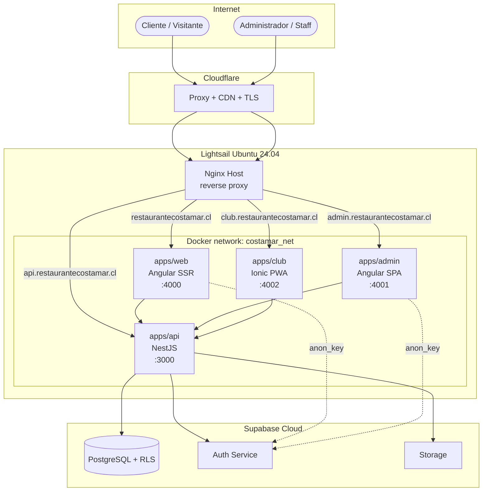
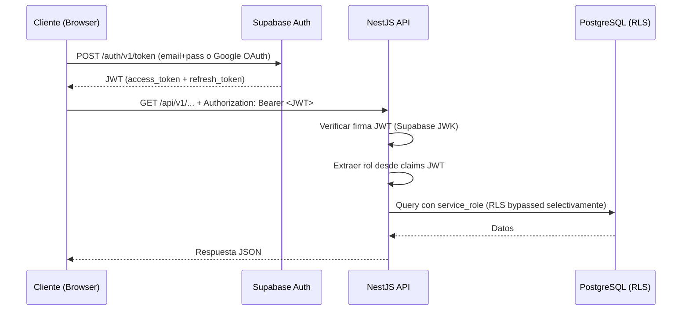
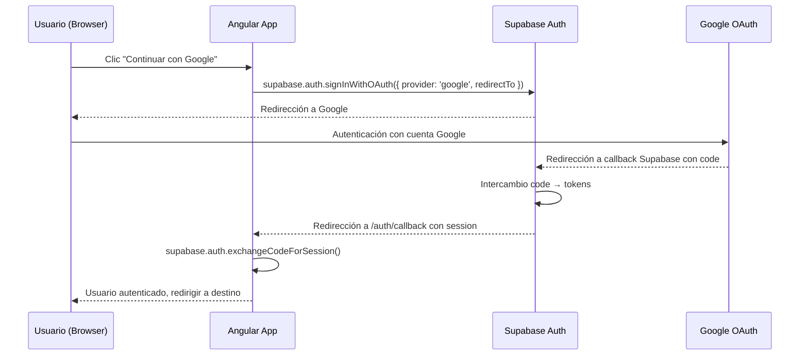

# Diseño Técnico — Plataforma Digital Costa Mar Barra Cevichera

## Visión General

La Plataforma Digital Costa Mar es un sistema integral para la gestión operativa de un restaurante,
compuesto por cuatro aplicaciones Angular/Ionic más una API NestJS, organizadas en un monorepo
TypeScript. El sistema utiliza Supabase Cloud como backend de datos y autenticación, se despliega en
AWS Lightsail con Docker Compose, y expone sus dominios a través de Nginx como proxy inverso y
Cloudflare como CDN/DNS.

### Objetivos de diseño

- **Operabilidad desde el día 1**: el primer sprint entrega un sistema funcional de extremo a extremo.
- **Seguridad por diseño**: RLS en Supabase, JWT validados en la API, `service_role` nunca en el
  cliente, TLS gestionado por Cloudflare.
- **Separación clara de responsabilidades**: monorepo con frontends, API y paquete compartido
  desacoplados.
- **Desplegabilidad reproducible**: Docker Compose en producción y desarrollo, CI/CD automatizado.
- **Escalabilidad progresiva**: módulos independientes que se habilitan incrementalmente.

---

## Arquitectura

### Diagrama de alto nivel



### Flujo de autenticación



### Principios de despliegue

| Capa | Tecnología | Ubicación |
|---|---|---|
| DNS / Proxy / TLS | Cloudflare Free | Externo |
| Reverse proxy | Nginx 1.24 | Host Lightsail |
| Contenedores | Docker Compose | Host Lightsail |
| Base de datos | Supabase PostgreSQL | Supabase Cloud |
| Auth | Supabase Auth + Google OAuth | Supabase Cloud |
| Storage | Supabase Storage | Supabase Cloud |

---

## Configuración de Autenticación Google OAuth (Estado: configurado, pendiente de validación)

### Proyecto Google Cloud

- Nombre del proyecto: **Costa Mar Plataforma**
- Tipo de credencial: Cliente OAuth 2.0 para aplicación web
- Propósito: autenticación de clientes y administradores mediante cuentas Google

### Proyecto Supabase Cloud

- Project reference: `pebdhasajkvsjttclbhf`
- Project URL: `https://pebdhasajkvsjttclbhf.supabase.co`
- Proveedor Google: **habilitado** en Authentication → Sign In / Providers → Google
- Client ID y Client Secret: configurados en Supabase (el secret nunca va al frontend)
- Skip nonce checks: desactivado
- Allow users without email: desactivado

### Callback URI (registrar en Google Cloud)

```
https://pebdhasajkvsjttclbhf.supabase.co/auth/v1/callback
```

Esta URI debe estar en la lista de **Authorized redirect URIs** del cliente OAuth en Google Cloud.
Google redirige aquí; Supabase procesa la sesión y luego redirige al frontend.

### URL Configuration en Supabase (Authentication → URL Configuration)

| Campo | Valor |
|---|---|
| Site URL | `https://restaurantecostamar.cl` |
| Redirect URLs | `https://restaurantecostamar.cl/auth/callback` |
| | `https://admin.restaurantecostamar.cl/auth/callback` |
| | `http://localhost:4200/auth/callback` |

### Flujo OAuth PKCE completo



### Reglas de seguridad OAuth

- `window.location.origin` solo debe usarse en contexto browser (no SSR); usar `isPlatformBrowser()` en Angular.
- El `redirectTo` debe apuntar a una URL registrada en Supabase URL Configuration.
- El Google Client Secret está almacenado exclusivamente en Supabase; nunca en Angular ni en el repositorio.
- La autenticación Google otorga identidad, no autorización administrativa. Los roles se asignan por separado.
- El primer superadmin se crea mediante migración SQL controlada, no desde el registro público.
- Scopes solicitados a Google: solo `openid`, `email` y `profile`. No solicitar acceso a Gmail, Drive ni Contacts.

---

## Componentes e Interfaces

### Estructura del monorepo

```
costamar/
├── apps/
│   ├── web/          # Angular 18+ SSR — restaurantecostamar.cl
│   ├── admin/        # Angular 18+ SPA — admin.restaurantecostamar.cl
│   ├── club/         # Ionic 7+ / Angular PWA — club.restaurantecostamar.cl
│   └── api/          # NestJS 10+ — api.restaurantecostamar.cl
├── packages/
│   └── shared/       # Tipos TypeScript, constantes, utilidades
├── nginx/
│   └── *.conf        # Configuraciones Nginx
├── docs/
│   └── deployment.md
├── .github/
│   └── workflows/    # GitHub Actions CI/CD
├── docker-compose.yml
├── docker-compose.override.yml  # solo dev
├── .env.example
├── .gitignore
└── package.json      # workspace root
```

### packages/shared

Exporta interfaces TypeScript reutilizables por todas las apps. Compilado como ESM/CJS con `tsc --watch` en desarrollo.

```typescript
// packages/shared/src/index.ts (exports principales)
export * from './types/auth';
export * from './types/carta';
export * from './types/orders';
export * from './types/inventory';
export * from './types/reservations';
export * from './types/loyalty';
export * from './types/reports';
export * from './constants/roles';
export * from './constants/order-states';
```

### apps/api (NestJS)

Organizado en módulos NestJS por dominio:

```
apps/api/src/
├── main.ts
├── app.module.ts
├── common/
│   ├── guards/          # AuthGuard, RolesGuard
│   ├── decorators/      # @Roles(), @PublicRoute()
│   ├── filters/         # GlobalExceptionFilter
│   ├── interceptors/    # LoggingInterceptor
│   └── pipes/           # ValidationPipe
├── supabase/            # SupabaseModule (cliente service_role)
├── auth/                # JWT strategy, validación claims
├── users/               # CRUD usuarios y roles
├── carta/               # Categorías, Productos, Variantes
├── reservations/        # Reservas, Mesas
├── orders/              # Pedidos, ciclo de vida
├── inventory/           # Ingredientes, stock, movimientos
├── suppliers/           # Proveedores, órdenes de compra
├── recipes/             # Recetas, costos
├── loyalty/             # Club, puntos, niveles
├── crm/                 # Perfiles, segmentación, cupones
├── reports/             # Endpoints de reportes
└── health/              # Health check endpoint
```

**Interfaces clave de la API:**

```typescript
// Respuesta estándar de error
interface ApiError {
  statusCode: number;
  message: string;
  timestamp: string;
}

// Respuesta health
interface HealthResponse {
  status: 'ok' | 'degraded';
  timestamp: string;
  version: string;
  components?: Record<string, { status: string; detail?: string }>;
}

// Guard de roles
@Injectable()
class RolesGuard implements CanActivate {
  canActivate(context: ExecutionContext): boolean;
  // Extrae el rol desde JWT claims, sin consultar DB
}
```

### apps/web (Angular SSR)

```
apps/web/src/
├── app/
│   ├── core/           # Interceptors HTTP, servicios globales
│   ├── shared/         # Componentes UI reutilizables
│   ├── pages/
│   │   ├── home/
│   │   ├── carta/
│   │   ├── reservas/
│   │   ├── pedidos/
│   │   └── club/
│   └── app.config.ts   # provideServerRendering()
```

### apps/admin (Angular SPA)

```
apps/admin/src/
├── app/
│   ├── core/
│   │   ├── guards/     # AuthGuard, RoleGuard
│   │   └── services/   # AuthService, ApiService
│   ├── features/
│   │   ├── dashboard/
│   │   ├── carta/
│   │   ├── reservas/
│   │   ├── pedidos/
│   │   ├── inventario/
│   │   ├── proveedores/
│   │   ├── recetas/
│   │   ├── club/
│   │   ├── crm/
│   │   ├── reportes/
│   │   └── usuarios/
│   └── app.routes.ts
```

### apps/club (Ionic PWA)

```
apps/club/src/
├── app/
│   ├── pages/
│   │   ├── home/       # Saldo, nivel, beneficios
│   │   ├── historial/
│   │   ├── qr/         # Código QR del cliente
│   │   └── canjear/
│   └── services/
│       └── loyalty.service.ts
```

---

## Modelos de Datos

### Identidad y Acceso

```sql
-- Perfil extendido del usuario (espeja auth.users de Supabase)
CREATE TABLE profiles (
  id           UUID PRIMARY KEY REFERENCES auth.users(id) ON DELETE CASCADE,
  full_name    TEXT NOT NULL,
  phone        TEXT,
  birth_date   DATE,
  avatar_url   TEXT,
  created_at   TIMESTAMPTZ NOT NULL DEFAULT now(),
  updated_at   TIMESTAMPTZ NOT NULL DEFAULT now()
);

-- Miembros del staff (empleados internos)
CREATE TABLE staff_members (
  id           UUID PRIMARY KEY DEFAULT gen_random_uuid(),
  profile_id   UUID NOT NULL REFERENCES profiles(id),
  employee_code TEXT UNIQUE,
  is_active    BOOLEAN NOT NULL DEFAULT true,
  created_at   TIMESTAMPTZ NOT NULL DEFAULT now()
);

-- Roles del sistema
CREATE TABLE roles (
  id   SMALLINT PRIMARY KEY GENERATED ALWAYS AS IDENTITY,
  name TEXT NOT NULL UNIQUE
  -- Valores: superadmin, admin, manager, kitchen, inventory, cashier, customer
);

-- Asignación de roles a usuarios
CREATE TABLE user_roles (
  user_id    UUID NOT NULL REFERENCES profiles(id) ON DELETE CASCADE,
  role_id    SMALLINT NOT NULL REFERENCES roles(id),
  granted_by UUID REFERENCES profiles(id),
  granted_at TIMESTAMPTZ NOT NULL DEFAULT now(),
  PRIMARY KEY (user_id, role_id)
);
```

### Carta Digital

```sql
CREATE TABLE categories (
  id          UUID PRIMARY KEY DEFAULT gen_random_uuid(),
  name        TEXT NOT NULL,
  description TEXT,
  position    SMALLINT NOT NULL DEFAULT 0,
  is_active   BOOLEAN NOT NULL DEFAULT true,
  created_at  TIMESTAMPTZ NOT NULL DEFAULT now()
);

CREATE TABLE products (
  id            UUID PRIMARY KEY DEFAULT gen_random_uuid(),
  category_id   UUID NOT NULL REFERENCES categories(id),
  name          TEXT NOT NULL,
  description   TEXT,
  base_price    NUMERIC(10,2) NOT NULL,
  is_available  BOOLEAN NOT NULL DEFAULT true,
  position      SMALLINT NOT NULL DEFAULT 0,
  created_at    TIMESTAMPTZ NOT NULL DEFAULT now(),
  updated_at    TIMESTAMPTZ NOT NULL DEFAULT now()
);

CREATE TABLE product_variants (
  id         UUID PRIMARY KEY DEFAULT gen_random_uuid(),
  product_id UUID NOT NULL REFERENCES products(id) ON DELETE CASCADE,
  name       TEXT NOT NULL,  -- ej.: "Grande", "Caliente"
  price      NUMERIC(10,2) NOT NULL,
  is_active  BOOLEAN NOT NULL DEFAULT true
);

CREATE TABLE product_images (
  id          UUID PRIMARY KEY DEFAULT gen_random_uuid(),
  product_id  UUID NOT NULL REFERENCES products(id) ON DELETE CASCADE,
  storage_path TEXT NOT NULL,  -- path en Supabase Storage
  position    SMALLINT NOT NULL DEFAULT 0,
  created_at  TIMESTAMPTZ NOT NULL DEFAULT now()
);
```

### Reservas

```sql
CREATE TABLE restaurant_tables (
  id          UUID PRIMARY KEY DEFAULT gen_random_uuid(),
  table_number SMALLINT NOT NULL UNIQUE,
  capacity    SMALLINT NOT NULL,
  is_active   BOOLEAN NOT NULL DEFAULT true
);

CREATE TABLE reservations (
  id              UUID PRIMARY KEY DEFAULT gen_random_uuid(),
  customer_name   TEXT NOT NULL,
  customer_phone  TEXT NOT NULL,
  customer_email  TEXT,
  party_size      SMALLINT NOT NULL,
  reserved_at     TIMESTAMPTZ NOT NULL,
  status          TEXT NOT NULL DEFAULT 'pendiente',
  -- estados: pendiente, confirmada, cancelada, completada
  table_id        UUID REFERENCES restaurant_tables(id),
  notes           TEXT,
  created_at      TIMESTAMPTZ NOT NULL DEFAULT now(),
  updated_at      TIMESTAMPTZ NOT NULL DEFAULT now()
);

CREATE TABLE reservation_events (
  id             UUID PRIMARY KEY DEFAULT gen_random_uuid(),
  reservation_id UUID NOT NULL REFERENCES reservations(id),
  event_type     TEXT NOT NULL,  -- confirmada, cancelada, etc.
  actor_id       UUID REFERENCES profiles(id),
  created_at     TIMESTAMPTZ NOT NULL DEFAULT now()
);
```

### Pedidos

```sql
CREATE TABLE orders (
  id            UUID PRIMARY KEY DEFAULT gen_random_uuid(),
  customer_id   UUID REFERENCES profiles(id),
  modality      TEXT NOT NULL,  -- retiro, delivery
  status        TEXT NOT NULL DEFAULT 'recibido',
  -- estados: recibido, en_preparacion, listo, entregado, cancelado
  total_amount  NUMERIC(10,2) NOT NULL DEFAULT 0,
  discount      NUMERIC(10,2) NOT NULL DEFAULT 0,
  contact_name  TEXT NOT NULL,
  contact_phone TEXT NOT NULL,
  delivery_address TEXT,
  notes         TEXT,
  created_at    TIMESTAMPTZ NOT NULL DEFAULT now(),
  updated_at    TIMESTAMPTZ NOT NULL DEFAULT now()
);

CREATE TABLE order_items (
  id          UUID PRIMARY KEY DEFAULT gen_random_uuid(),
  order_id    UUID NOT NULL REFERENCES orders(id) ON DELETE CASCADE,
  product_id  UUID NOT NULL REFERENCES products(id),
  variant_id  UUID REFERENCES product_variants(id),
  quantity    SMALLINT NOT NULL,
  unit_price  NUMERIC(10,2) NOT NULL,
  subtotal    NUMERIC(10,2) GENERATED ALWAYS AS (quantity * unit_price) STORED
);

CREATE TABLE payments (
  id         UUID PRIMARY KEY DEFAULT gen_random_uuid(),
  order_id   UUID NOT NULL REFERENCES orders(id),
  method     TEXT NOT NULL,  -- efectivo, transbank, mercadopago
  amount     NUMERIC(10,2) NOT NULL,
  status     TEXT NOT NULL DEFAULT 'pendiente',
  paid_at    TIMESTAMPTZ,
  created_at TIMESTAMPTZ NOT NULL DEFAULT now()
);

CREATE TABLE payment_events (
  id         UUID PRIMARY KEY DEFAULT gen_random_uuid(),
  payment_id UUID NOT NULL REFERENCES payments(id),
  event_type TEXT NOT NULL,
  actor_id   UUID REFERENCES profiles(id),
  created_at TIMESTAMPTZ NOT NULL DEFAULT now()
);
```

### Inventario

```sql
CREATE TABLE units (
  id     SMALLINT PRIMARY KEY GENERATED ALWAYS AS IDENTITY,
  name   TEXT NOT NULL UNIQUE,  -- kg, g, L, mL, unidad
  symbol TEXT NOT NULL UNIQUE
);

CREATE TABLE unit_conversions (
  from_unit_id SMALLINT NOT NULL REFERENCES units(id),
  to_unit_id   SMALLINT NOT NULL REFERENCES units(id),
  factor       NUMERIC(18,8) NOT NULL,
  PRIMARY KEY (from_unit_id, to_unit_id)
);

CREATE TABLE ingredients (
  id             UUID PRIMARY KEY DEFAULT gen_random_uuid(),
  name           TEXT NOT NULL,
  unit_id        SMALLINT NOT NULL REFERENCES units(id),
  current_stock  NUMERIC(18,4) NOT NULL DEFAULT 0,
  reorder_point  NUMERIC(18,4) NOT NULL DEFAULT 0,
  unit_cost      NUMERIC(10,4) NOT NULL DEFAULT 0,
  is_active      BOOLEAN NOT NULL DEFAULT true,
  created_at     TIMESTAMPTZ NOT NULL DEFAULT now(),
  updated_at     TIMESTAMPTZ NOT NULL DEFAULT now()
);

CREATE TABLE stock_locations (
  id   UUID PRIMARY KEY DEFAULT gen_random_uuid(),
  name TEXT NOT NULL UNIQUE  -- bodega principal, refrigerador, etc.
);

CREATE TABLE stock_lots (
  id            UUID PRIMARY KEY DEFAULT gen_random_uuid(),
  ingredient_id UUID NOT NULL REFERENCES ingredients(id),
  location_id   UUID REFERENCES stock_locations(id),
  quantity      NUMERIC(18,4) NOT NULL,
  unit_cost     NUMERIC(10,4) NOT NULL,
  received_at   TIMESTAMPTZ NOT NULL DEFAULT now(),
  expiry_date   DATE
);

CREATE TABLE stock_movements (
  id            UUID PRIMARY KEY DEFAULT gen_random_uuid(),
  ingredient_id UUID NOT NULL REFERENCES ingredients(id),
  lot_id        UUID REFERENCES stock_lots(id),
  movement_type TEXT NOT NULL,  -- entrada, salida, merma, ajuste
  quantity      NUMERIC(18,4) NOT NULL,
  reason        TEXT,
  actor_id      UUID NOT NULL REFERENCES profiles(id),
  created_at    TIMESTAMPTZ NOT NULL DEFAULT now()
);

CREATE TABLE inventory_counts (
  id            UUID PRIMARY KEY DEFAULT gen_random_uuid(),
  counted_at    TIMESTAMPTZ NOT NULL DEFAULT now(),
  actor_id      UUID NOT NULL REFERENCES profiles(id),
  notes         TEXT
);
```

### Recetas

```sql
CREATE TABLE recipes (
  id          UUID PRIMARY KEY DEFAULT gen_random_uuid(),
  product_id  UUID NOT NULL UNIQUE REFERENCES products(id),
  yield       NUMERIC(8,2) NOT NULL DEFAULT 1,  -- porciones
  notes       TEXT,
  created_at  TIMESTAMPTZ NOT NULL DEFAULT now(),
  updated_at  TIMESTAMPTZ NOT NULL DEFAULT now()
);

CREATE TABLE recipe_versions (
  id         UUID PRIMARY KEY DEFAULT gen_random_uuid(),
  recipe_id  UUID NOT NULL REFERENCES recipes(id),
  version    SMALLINT NOT NULL DEFAULT 1,
  created_at TIMESTAMPTZ NOT NULL DEFAULT now(),
  created_by UUID REFERENCES profiles(id)
);

CREATE TABLE recipe_ingredients (
  id            UUID PRIMARY KEY DEFAULT gen_random_uuid(),
  recipe_id     UUID NOT NULL REFERENCES recipes(id),
  ingredient_id UUID NOT NULL REFERENCES ingredients(id),
  quantity      NUMERIC(18,4) NOT NULL,
  unit_id       SMALLINT NOT NULL REFERENCES units(id),
  UNIQUE (recipe_id, ingredient_id)
);
```

### Compras

```sql
CREATE TABLE suppliers (
  id             UUID PRIMARY KEY DEFAULT gen_random_uuid(),
  name           TEXT NOT NULL,
  rut            TEXT UNIQUE,
  contact_name   TEXT,
  phone          TEXT,
  email          TEXT,
  payment_terms  TEXT,
  is_active      BOOLEAN NOT NULL DEFAULT true,
  created_at     TIMESTAMPTZ NOT NULL DEFAULT now()
);

CREATE TABLE purchase_orders (
  id               UUID PRIMARY KEY DEFAULT gen_random_uuid(),
  supplier_id      UUID NOT NULL REFERENCES suppliers(id),
  status           TEXT NOT NULL DEFAULT 'borrador',
  -- estados: borrador, enviada, recibida_parcial, recibida_completa, cancelada
  total_amount     NUMERIC(10,2) NOT NULL DEFAULT 0,
  estimated_delivery DATE,
  created_by       UUID NOT NULL REFERENCES profiles(id),
  created_at       TIMESTAMPTZ NOT NULL DEFAULT now(),
  updated_at       TIMESTAMPTZ NOT NULL DEFAULT now()
);

CREATE TABLE purchase_order_items (
  id                UUID PRIMARY KEY DEFAULT gen_random_uuid(),
  purchase_order_id UUID NOT NULL REFERENCES purchase_orders(id) ON DELETE CASCADE,
  ingredient_id     UUID NOT NULL REFERENCES ingredients(id),
  quantity_ordered  NUMERIC(18,4) NOT NULL,
  quantity_received NUMERIC(18,4) NOT NULL DEFAULT 0,
  unit_price        NUMERIC(10,4) NOT NULL,
  subtotal          NUMERIC(10,2) GENERATED ALWAYS AS (quantity_ordered * unit_price) STORED
);

CREATE TABLE goods_receipts (
  id                UUID PRIMARY KEY DEFAULT gen_random_uuid(),
  purchase_order_id UUID NOT NULL REFERENCES purchase_orders(id),
  received_by       UUID NOT NULL REFERENCES profiles(id),
  received_at       TIMESTAMPTZ NOT NULL DEFAULT now(),
  notes             TEXT
);
```

### Fidelización

```sql
CREATE TABLE loyalty_accounts (
  id           UUID PRIMARY KEY DEFAULT gen_random_uuid(),
  customer_id  UUID NOT NULL UNIQUE REFERENCES profiles(id),
  points       INTEGER NOT NULL DEFAULT 0,
  level        TEXT NOT NULL DEFAULT 'bronce',
  enrolled_at  TIMESTAMPTZ NOT NULL DEFAULT now(),
  updated_at   TIMESTAMPTZ NOT NULL DEFAULT now()
);

CREATE TABLE loyalty_transactions (
  id          UUID PRIMARY KEY DEFAULT gen_random_uuid(),
  account_id  UUID NOT NULL REFERENCES loyalty_accounts(id),
  type        TEXT NOT NULL,  -- acreditar, canjear, expirar, ajuste
  points      INTEGER NOT NULL,
  order_id    UUID REFERENCES orders(id),
  description TEXT,
  created_at  TIMESTAMPTZ NOT NULL DEFAULT now()
);

CREATE TABLE rewards (
  id              UUID PRIMARY KEY DEFAULT gen_random_uuid(),
  name            TEXT NOT NULL,
  description     TEXT,
  points_cost     INTEGER NOT NULL,
  is_active       BOOLEAN NOT NULL DEFAULT true,
  valid_from      DATE,
  valid_until     DATE
);

CREATE TABLE reward_redemptions (
  id          UUID PRIMARY KEY DEFAULT gen_random_uuid(),
  account_id  UUID NOT NULL REFERENCES loyalty_accounts(id),
  reward_id   UUID NOT NULL REFERENCES rewards(id),
  order_id    UUID REFERENCES orders(id),
  redeemed_at TIMESTAMPTZ NOT NULL DEFAULT now()
);
```

### Seguridad y Auditoría

```sql
CREATE TABLE audit_logs (
  id          UUID PRIMARY KEY DEFAULT gen_random_uuid(),
  actor_id    UUID REFERENCES profiles(id),
  action      TEXT NOT NULL,
  table_name  TEXT NOT NULL,
  record_id   UUID,
  old_data    JSONB,
  new_data    JSONB,
  ip_address  INET,
  created_at  TIMESTAMPTZ NOT NULL DEFAULT now()
);

CREATE TABLE notification_events (
  id           UUID PRIMARY KEY DEFAULT gen_random_uuid(),
  recipient_id UUID REFERENCES profiles(id),
  type         TEXT NOT NULL,  -- email, sms, push
  template     TEXT NOT NULL,
  payload      JSONB,
  status       TEXT NOT NULL DEFAULT 'pendiente',
  sent_at      TIMESTAMPTZ,
  created_at   TIMESTAMPTZ NOT NULL DEFAULT now()
);

CREATE TABLE customer_consents (
  id           UUID PRIMARY KEY DEFAULT gen_random_uuid(),
  customer_id  UUID NOT NULL REFERENCES profiles(id),
  consent_type TEXT NOT NULL,  -- marketing, terminos
  granted      BOOLEAN NOT NULL,
  granted_at   TIMESTAMPTZ NOT NULL DEFAULT now()
);
```

---

## Propiedades de Corrección

*Una propiedad es una característica o comportamiento que debe mantenerse verdadero en todas las
ejecuciones válidas del sistema — esencialmente, una declaración formal sobre lo que el sistema debe
hacer. Las propiedades sirven como puente entre las especificaciones legibles por humanos y las
garantías de corrección verificables por máquina.*

### Propiedad 1: Validación de roles

*Para cualquier* rol enviado al endpoint de asignación, si el rol no está en el conjunto exacto
`{superadmin, admin, manager, kitchen, inventory, cashier, customer}`, la API debe rechazar la
operación con HTTP 400.

**Valida: Requisito 4.3**

---

### Propiedad 2: Extracción de rol desde JWT sin consulta a BD

*Para cualquier* JWT válido emitido por Supabase, la API debe poder determinar el rol del usuario
extrayendo únicamente los claims del token, sin realizar ninguna consulta adicional a la base de datos
durante la validación de acceso.

**Valida: Requisito 3.4**

---

### Propiedad 3: Stock nunca negativo

*Para cualquier* ingrediente y cualquier operación de salida de inventario, si la cantidad a descontar
supera el stock actual, la operación debe ser rechazada con HTTP 409 y el stock debe permanecer
inalterado.

**Valida: Requisito 11.4**

---

### Propiedad 4: Cálculo de costo de receta es consistente

*Para cualquier* receta con N ingredientes, el costo por porción calculado debe ser igual a
`(Σ cantidad_i × costo_unitario_i) / rendimiento`, y este valor debe recalcularse automáticamente
cuando se actualiza el costo de cualquier ingrediente incluido en la receta.

**Valida: Requisitos 13.3, 13.4**

---

### Propiedad 5: Puntos de fidelización son coherentes con los movimientos

*Para cualquier* cuenta de lealtad, el saldo de puntos actual debe ser igual a la suma algebraica de
todos los movimientos `loyalty_transactions` asociados a esa cuenta (positivos para acreditar,
negativos para canjear/expirar).

**Valida: Requisito 14.2, 14.9**

---

### Propiedad 6: Canje de puntos requiere saldo suficiente

*Para cualquier* cliente y cualquier canje solicitado, si los puntos a canjear superan el saldo
disponible en `loyalty_accounts.points`, la operación debe ser rechazada y el saldo debe permanecer
inalterado.

**Valida: Requisito 14.9**

---

### Propiedad 7: Cupones respetan sus restricciones de uso

*Para cualquier* cupón y cualquier pedido que lo aplique, si el cupón está vencido o ha alcanzado su
límite de usos totales o por cliente, la API debe rechazar la aplicación con HTTP 422. El contador de
usos solo se decrementa en aplicaciones exitosas.

**Valida: Requisitos 15.5, 15.6**

---

### Propiedad 8: Total de orden de compra es consistente

*Para cualquier* orden de compra con N ítems, el campo `total_amount` debe ser igual a
`Σ (quantity_ordered_i × unit_price_i)` para todos los ítems de esa orden.

**Valida: Requisito 12.6**

---

### Propiedad 9: Transiciones de estado de pedido son válidas

*Para cualquier* pedido, una solicitud de cancelación emitida por el cliente cuando el pedido tiene
estado `en_preparacion` o `listo` debe ser rechazada. El estado debe permanecer sin cambios.

**Valida: Requisito 10.6**

---

### Propiedad 10: Unicidad de receta por producto

*Para cualquier* producto, solo puede existir una receta activa asociada a él. Intentar crear una
segunda receta para el mismo producto debe ser rechazado.

**Valida: Requisito 13.1** (integridad del modelo de datos)

---

### Propiedad 11: Health endpoint refleja estado real de Supabase

*Para cualquier* estado de la conexión a Supabase, el health endpoint debe retornar HTTP 200 con
`status: "ok"` cuando la conexión es exitosa, y HTTP 503 con `status: "degraded"` cuando la conexión
falla. Nunca debe retornar un estado inconsistente con la conectividad real.

**Valida: Requisito 5.1, 5.2**

---

### Propiedad 12: Reservas respetan disponibilidad

*Para cualquier* franja horaria completamente ocupada, una solicitud de reserva para esa misma franja
debe ser rechazada con HTTP 409, independientemente de los datos del solicitante.

**Valida: Requisito 9.3**

---

### Propiedad 13: Carta solo retorna productos disponibles en consultas públicas

*Para cualquier* consulta pública de la carta, todos los productos retornados deben tener
`is_available = true`. Productos desactivados no deben aparecer en las respuestas públicas.

**Valida: Requisito 8.7**

---

## Manejo de Errores

### Formato de error estándar

Todos los errores de la API devuelven el mismo esquema JSON:

```json
{
  "statusCode": 409,
  "message": "No se puede eliminar la categoría: contiene 3 producto(s) activo(s).",
  "timestamp": "2025-01-15T14:32:00.000Z"
}
```

### Tabla de errores por dominio

| Dominio | Situación | Código HTTP |
|---|---|---|
| Auth | JWT expirado o inválido | 401 |
| Auth | Sin permisos para el recurso | 403 |
| Roles | Rol no válido en asignación | 400 |
| Carta | Categoría con productos al eliminar | 409 |
| Reservas | Franja sin disponibilidad | 409 |
| Pedidos | Cancelación en estado no permitido | 422 |
| Pedidos | Producto no disponible al confirmar | 409 |
| Inventario | Salida que resulta en stock negativo | 409 |
| Recetas | Eliminación de ingrediente en receta | 409 |
| Fidelización | Canje sin saldo suficiente | 422 |
| Cupones | Cupón vencido o agotado | 422 |
| General | Validación de parámetros | 400 |
| General | Recurso no encontrado | 404 |
| General | Error interno del servidor | 500 |
| Supabase | Conexión no disponible | 503 |

### Estrategia de reintentos

- La API **no reintenta** operaciones hacia Supabase por cuenta propia en el path de solicitud normal;
  los clientes son responsables de los reintentos.
- La única excepción son las operaciones de escritura en `audit_logs`: si fallan, se registran en un
  log estructurado local sin interrumpir el flujo principal.

### Logs estructurados

Cada solicitud genera un log JSON con los campos:

```json
{
  "level": "info",
  "method": "POST",
  "path": "/api/v1/inventory/ingredients",
  "statusCode": 201,
  "durationMs": 45,
  "userId": "uuid",
  "role": "inventory",
  "timestamp": "2025-01-15T14:32:00.000Z"
}
```

Los campos **nunca** registrados en logs: `password`, `token`, `service_role`, `secret`, números de
tarjeta.

---

## Estrategia de Testing

### Enfoque dual: unit tests + property-based tests

Ambas categorías son complementarias y necesarias:

- **Unit tests**: verifican ejemplos concretos, casos borde e integraciones entre componentes.
- **Property tests**: verifican propiedades universales a través de muchas entradas generadas
  aleatoriamente.

### Herramientas por aplicación

| App | Unit Testing | Property Testing |
|---|---|---|
| apps/api | Jest + @nestjs/testing | fast-check |
| apps/web | Karma + Jasmine (Angular default) | fast-check |
| apps/admin | Karma + Jasmine | fast-check |
| apps/club | Karma + Jasmine | fast-check |
| packages/shared | Jest | fast-check |

### Unit tests — énfasis

Evitar duplicar con property tests. Focalizarse en:

- **Ejemplos de integración**: flujo login → JWT → guard → controlador
- **Casos borde con valores específicos**: stock exactamente en 0, cupón con exactamente 1 uso restante
- **Error handling de módulos externos**: mock de Supabase con error de red
- **Transformaciones de datos con entradas conocidas**: cálculo de costo de receta con valores fijos

### Property tests — configuración

- Mínimo **100 iteraciones** por test de propiedad (configurado en `fast-check`).
- Cada test debe incluir un comentario de trazabilidad:

```typescript
// Feature: costamar-platform, Propiedad 3: Stock nunca negativo
it('rechaza salida que cause stock negativo', () => {
  fc.assert(
    fc.property(
      fc.record({ stock: fc.float({ min: 0, max: 1000 }), salida: fc.float({ min: 0, max: 2000 }) }),
      ({ stock, salida }) => {
        fc.pre(salida > stock);
        const resultado = inventoryService.validateExit(stock, salida);
        expect(resultado.allowed).toBe(false);
      }
    ),
    { numRuns: 100 }
  );
});
```

### Cobertura mínima del primer entregable (Requisito 19)

- Lógica de autenticación (AuthGuard, RolesGuard): unit tests + property tests Prop 1 y Prop 2
- Health endpoint: unit test de respuesta ok + unit test de degraded
- CRUD Ingredientes: unit tests de creación/lectura/actualización/eliminación + property test Prop 3

### CI/CD y calidad

- El pipeline ejecuta `pnpm test --run` en cada PR antes del merge.
- Análisis estático de seguridad con `semgrep` o `trivy` en cada PR.
- El despliegue solo avanza si el health endpoint responde HTTP 200 post-deploy.
